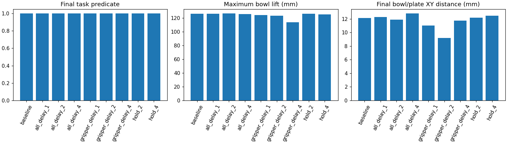
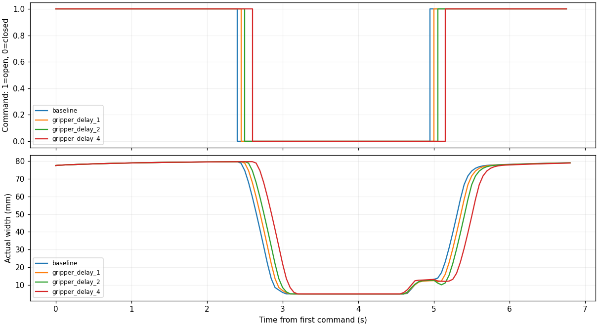

# GlanceWAM Light：机器人控制与数据管线验收

面向 GlanceWAM 动作模块后训练的验证工程。先在 **2GiB 内存、无 GPU** 的服务器上完成控制与数据管线验收，再在单张 A100 40GB 上完成动作模块微调和闭环对照。

**最新：完成 C/P 阶段采样各100步训练，以及围绕偏色状态 33 的三轮失败定位。** C/P 正常条件均20/20，强偏色分别16/20与15/20（基线15/20）；P 恢复26条但新增33条失败，未优于 C，阶段重采样暂不推进。状态33 定位显示 P 在抓取接触尚未稳定时于动作56提前张爪，最大抬升仅4.29mm；只保持56–75闭爪的反事实把窗口抬升提到32.51mm、相对漂移从72.89mm降到8.87mm，任务仍失败；进一步只读检查68–80确认72时接触由指垫转移到非指垫手指碰撞体并伴随9.61mm相对滑移，76时碗盘XY误差61.57mm（C为16.52mm）。固定失败动作的开环反事实不能当作新观测下的闭环输出，结论已列出下一步所需的带反馈诊断。诊断口径复核进一步表明，双侧指垫接触与「首次丢失时刻」都不是可靠的夹持判据。详见[阶段记录](results/stage_v1/comparison/实验记录.md)、[33号失败分析](results/failure_replay_33/失败原因分析.md)、[反事实记录](results/counterfactual_33_hold56_75/反事实回放记录.md)、[接触检查与下一步](results/counterfactual33_contact_68_80/阶段68_80分析与最小方案.md)、[诊断口径复核](results/contact_transfer/诊断口径复核.md)。全部来自单一任务、同一批初始状态，不是跨任务或实机结果。

**此前的120次独立初始状态闭环对照。** 正常/强偏色成功数：base 为20/20、15/20，clean200 为20/20、16/20，aug200 为19/20、15/20。增强微调没有偏色净收益，并出现正常条件退化，不能宣称鲁棒性提升。详见[独立状态实验记录](results/color_holdout/comparison/实验记录.md)、[配对结果与案例编号](results/color_holdout/comparison/overview.json)。

**2026-10-16 已完成单张 A100 40GB 的 clean/aug 各200步动作模块训练和90回合闭环抓取评测。** 原始模型与两组微调模型在正常、暗光和颜色偏移条件下均为10/10成功；本次未观察到成功率提升。详见 [200步对照实验记录](results/controlled_200/comparison/实验记录.md)。此前的推理、三步更新与检查点重载检查见 [GPU 部署验证记录](results/gpu_validation/GPU部署验证记录.md)。尚无实机结果。

## 已完成的实测

| 实验 | 结果 | 证据 |
|---|---|---|
| 单轴控制与固定动作 | 12 项方向检查通过；两次 150 步回放状态最大误差 0；原图/变暗/颜色变化对照 | [控制测试说明](day1/CPU控制测试说明.md)、[产物](results/cpu_control_diag/) |
| 官方仿真示范数据 | 抽取抽屉与抓取各 10 条轨迹，共 2321 帧；按轨迹划分训练 16 条 / 验证 4 条 | [抓取数据说明](day1/抓取示范验收与微调接入.md)、[划分](results/drawer_grasp_episode_split.json) |
| 动作接口与状态匹配 | 24 项目标缩放、14 项物理方向检查通过；匹配 LeRobot episode 0 与原始 HDF5 demo_10，112 步抓取放置成功 | [接口验收说明](day1/动作接口与示范回放验收.md)、[回放结果](results/matched_grasp_replay/) |
| 时序敏感性 | 同一条示范的 9 个条件均成功；夹爪延迟 200ms 后最大抬升下降约 9.9%，未找到失败边界 | [实验说明](day1/时序控制敏感性实验说明.md)、[完整结果](results/control_sensitivity/) |
| A100 动作模块验证 | 官方特征一致性、三步 AdamW 更新、冻结参数哈希与检查点重载均通过；推理峰值分配显存 3.45GiB，训练 5.21GiB | [GPU 记录](results/gpu_validation/GPU部署验证记录.md)、[指标](results/gpu_validation/overview.json) |
| Clean/Aug 200步对照 | 相同8条训练/2条验证轨迹、seed=42，冻结参数哈希一致；峰值分配显存均5.76GiB；三模型×三条件×10个初始状态均成功 | [实验记录](results/controlled_200/comparison/实验记录.md)、[曲线](results/controlled_200/comparison/loss_curves.png) |
| 扰动筛选与独立状态对照 | 基线在5个状态下正常/两档变暗均5/5，强偏色2/5；另20个状态×三模型×两条件，共120次；aug偏色恢复1条、新增失败1条，正常新增失败1条 | [筛选](results/perturbation_pilot/试验记录.md)、[正式结果](results/color_holdout/comparison/实验记录.md)、[成功率](results/color_holdout/comparison/success_rates.png) |
| 两条退化轨迹定位 | 回放39正常、32偏色下三个模型的原动作，六条均复现；39为初次搬运脱持和后续纠偏失败，32为下降不足、横向越位与松爪不协调；保存末端/碗/盘位姿与接触日志，无新增训练 | [失败分析](results/failure_replay_39_32/失败原因分析.md)、[逐模型指标](results/failure_replay_39_32/metrics.json) |
| C/P阶段采样100步 | C/P正常均20/20，偏色分别16/20与15/20；基线偏色15/20；P恢复26但新增33失败，未优于C；best/last均已保存，45–49保留 | [实验记录](results/stage_v1/comparison/实验记录.md)、[分阶段损失](results/stage_v1/comparison/phase_validation.png)、[闭环结果](results/stage_v1/comparison/closed_loop_success.png) |
| P偏色33退化定位 | 2GB CPU无渲染回放三条原动作，成功步数与初态哈希吻合；P夹持未稳定即在56张爪，最大抬升4.29mm，之后未重新抓取；无新增训练 | [失败分析](results/failure_replay_33/失败原因分析.md)、[关键曲线](results/failure_replay_33/color_strong_episode33/grasp_failure_focus.png)、[原录像对照](results/failure_replay_33/color_strong_episode33/original_policy_comparison.mp4) |
| 33号夹爪反事实 | 仅56–75保持闭爪，6维输入与其余动作不变，状态0–56逐位相同；窗口抬升4.29→32.51mm、相对漂移72.89→8.87mm，任务仍失败 | [记录与结论](results/counterfactual_33_hold56_75/反事实回放记录.md)、[曲线](results/counterfactual_33_hold56_75/grasp_comparison.png)、[末端系位置](results/counterfactual_33_hold56_75/bowl_relative_to_eef.png) |
| 33号接触几何检查 | 恢复3条轨迹×13个保存状态共39个状态，碗盘位姿1e-9核对通过、接触标志与原日志全一致；72时接触由指垫转移到非指垫手指碰撞体，71→73碗在末端系滑移9.61mm；76时碗盘XY误差61.57mm，未对齐 | [记录与下一步](results/counterfactual33_contact_68_80/阶段68_80分析与最小方案.md)、[接触分组](results/counterfactual33_contact_68_80/contact_groups.json)、[恢复校验](results/counterfactual33_contact_68_80/restore_checks.json)、[对齐分解](results/counterfactual33_contact_68_80/overview.json) |
| 诊断口径复核 | 复核九条轨迹（含手指级接触重跑）：39/aug双侧指垫接触0个状态却抬升100.03mm，39/base仅6个状态抬升110.12mm，双侧接触不能作为夹持判据；指垫与手指通道的首次空洞均为瞬态，需用末次接触与空档长度看；失败分两类：33/P从未建立夹持（末次接触抬升仅4.29mm、其后243状态空档），39/aug与32/aug抓住抬起但未完成放置 | [复核说明](results/contact_transfer/诊断口径复核.md)、[33号指标](results/contact_transfer/contact_transfer_33.json)、[39/32指标](results/contact_transfer/contact_transfer_39_32.json)、[接触与滑移曲线](results/contact_transfer/contact_transfer_33.png)、[接触重放证据](results/failure_replay_33_contact/replay_checks.json)、[分析脚本源码](results/contact_transfer/sources/analyze_contact_transfer.py) |

### 时序实验

固定相同初始状态、20Hz 控制和 136 步时长，比较基准、整体动作延后 50/100/200ms、仅夹爪延后 50/100/200ms、每 2/4 步刷新指令。

| 条件 | 最终任务成功 | 最大抬升 mm |
|---|---|---:|
| 基准 | 是 | 125.851 |
| 夹爪延迟 50ms | 是 | 124.263 |
| 夹爪延迟 100ms | 是 | 123.044 |
| 夹爪延迟 200ms | 是 | 113.429 |

[观看基准与夹爪延迟 200ms 并排视频](results/control_sensitivity/baseline_vs_perturbed.mp4)（左：基准；右：夹爪延迟；137 帧、20fps、6.85 秒）。GitHub 如不内嵌播放，可下载 MP4。

**结论边界：** 9 个条件来自同一条示范，不是 9 个独立任务，也不是策略成功率。延迟和频率均按仿真时间计算，CPU 运行慢于实时；整体动作延后只是固定动作流的起始时移；降低刷新频率时重复的是增量命令，不等同于 WAM 动作块执行。三种视觉条件属于同轨迹图像处理，未测视觉扰动下的策略鲁棒性。为降低内存，诊断资产只缩小纹理，物理文件不变；不用于官方视觉榜单比较。

## 阅读与复现

1. [部署与输入数据说明](docs/REPRODUCE.md)：环境、固定版本、数据来源、现有服务器命令与新机器前置条件。
2. [完整实施方案](day1/实施方案.md)：动作模块后训练与后续闭环评测路线。文档保留此前无 GPU 阶段的背景；当前 GPU 实测状态以部署验证记录为准。
3. [实测分析](results/control_sensitivity/analysis.md)：逐条件数值、限制与视频说明。
4. [C/P阶段微调代码与命令](docs/STAGE_FINETUNE.md)：交叉注意力/解码器微调、4/2/2阶段抽样、分阶段验证、动作模块增量检查点。已完成CPU审计及A100上C/P各100步训练；闭环开发集结果见[本轮记录](results/stage_v1/comparison/实验记录.md)。

目录：`day1/` 为代码和研究说明，`results/` 为已完成实验的曲线、视频、JSON/CSV 和状态数组，`docs/` 为部署与来源记录。仓库不包含模型权重、完整示范数据、第三方仿真资产或 Python 环境。

## 来源

- [GlanceWAM](https://github.com/linhanwang/GlanceWAM)，commit `6a51bdc5139e72e8ad525779db0c989e1af5abab`。
- [LIBERO](https://github.com/Lifelong-Robot-Learning/LIBERO)，commit `8f1084e3132a39270c3a13ebe37270a43ece2a01`。
- [GlanceWAM 数据与权重](https://huggingface.co/datasets/LinhanWang/GlanceWAM)，数据 revision `0b9208dff852914f94be879f702cd40118255bce`。
- [原始 LIBERO 示范](https://huggingface.co/datasets/yifengzhu-hf/LIBERO-datasets)，revision `f13aa24a3da8c43c7225569f28c562979fa0e35a`。

本仓库是配套研究与验收工程，与上述官方项目无隶属关系。第三方代码、数据和衍生产物的使用应遵循各自上游许可；此处不重新授予第三方材料许可。
