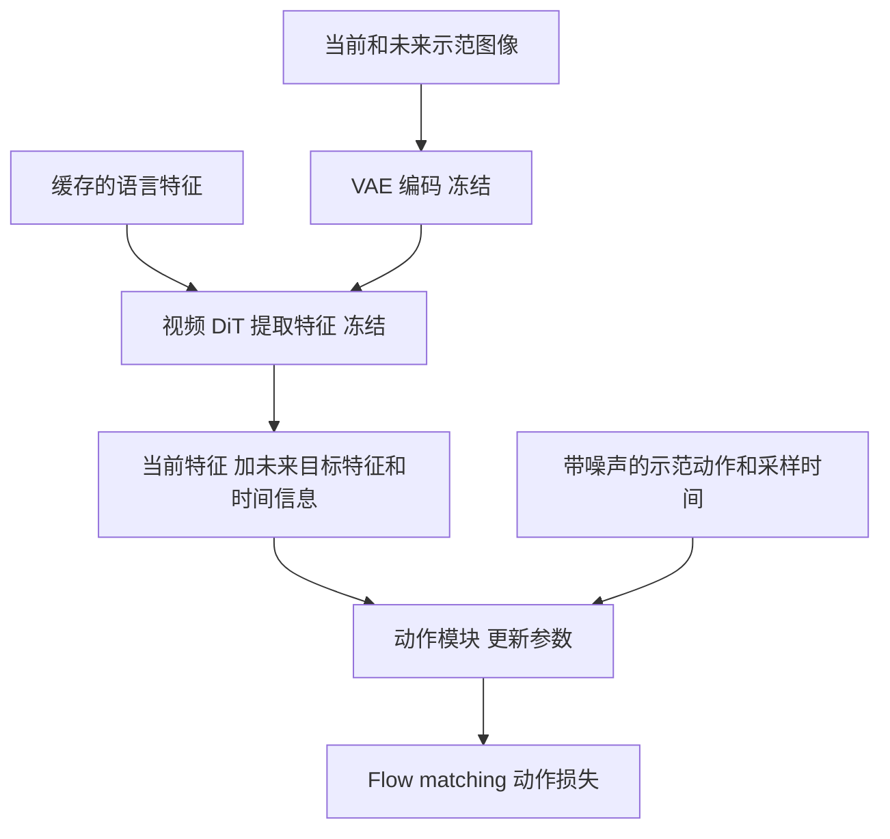

# GlanceWAM 单卡动作模块后训练与鲁棒控制实施方案

使用单张 A100 40GB，在 LIBERO 仿真中研究：冻结世界模型后，对动作模块进行小规模监督后训练，能否提高光照和颜色变化下的闭环任务成功率，同时保持正常场景能力。目标是一周内完成可复现代码、两组训练和三组闭环对照，不预设性能提升。

## 一 先解决运行条件

服务器当前检查结果：没有可见 NVIDIA GPU 设备，`/usr/bin/nvidia-smi` 是 0 字节占位文件；系统盘空闲约 2.3GB，数据盘空闲约 5.2GB。现阶段可以部署代码和运行 CPU 测试，不能声称已经完成 A100 训练。

在 AutoDL 中开启有 GPU 的实例并确认容器可访问设备。数据盘建议预留约 100GB，至少先准备 60GiB 空闲空间。此预算包括环境、基础模型、发布权重、数据、多个导出检查点和视频；实际下载量以文件大小为准。已有文件不自动删除。需要控制空间时减少编号检查点频率，不删除原始权重。

```bash
python day1/preflight.py --workspace . --require-gpu --out preflight_report.json
```

验收：真实可见 GPU、BF16 可用、显存至少约 38GiB、空闲空间满足门槛。若 Python 只安装了 CPU PyTorch，需要在独立项目环境安装 CUDA 版本后重新检查。不要修改其他项目的环境。

## 二 项目范围与假设

| 项目 | 固定设置 |
| --- | --- |
| 模型 | GlanceWAM 官方 LIBERO 检查点 |
| 源码提交 | `6a51bdc5139e72e8ad525779db0c989e1af5abab` |
| 仿真 | LIBERO，源码提交 `8f1084e3132a39270c3a13ebe37270a43ece2a01` |
| 后训练数据 | 官方发布的 `libero_goal` 示范，无需额外采集 |
| 主实验训练范围 | 冻结视频 DiT、VAE、文本组件、目标时间投影和 tap embedding，更新动作模块 |
| 输入输出 | 外部相机和腕部相机、语言条件；8 步 × 7 维归一化动作 |
| 实验组 | 原始检查点、干净数据微调、扰动增强微调 |
| 主结果 | 正常、暗光、颜色偏移下的闭环成功次数及总回合数 |

假设：冻结视频主干在扰动下仍能提供可用表示，动作模块可以通过监督后训练改善对这些表示的利用。如果扰动已使世界模型预测严重错误，动作模块微调可能无效；这是需要报告的结果。

训练采用示范中的未来目标，推理采用模型生成的未来目标。离线验证集仅对本次后训练留出，原始检查点可能已经见过这些示范，因此不能把它称为完全未见数据泛化测试。

## 三 模型和训练数据流



真实样本来自官方 LeRobot v3 数据。使用单数据集确定索引访问，不使用会重新随机抽轨迹的混合数据集索引。先按完整 episode 划分，再建立训练和验证帧索引。训练每轮打乱并持续遍历；验证样本、未来目标偏移和随机噪声固定。

每个训练窗口共享同一组亮度、饱和度和 RGB 增益，两路相机已按官方规则横向拼接。图像变换不改变几何位置、动作或语言标签。默认 50% 样本保持干净，50% 增强。亮度与饱和度范围均为 0.6 至 1.4，RGB 增益范围为 0.9 至 1.1。

动作损失沿用官方 flow matching：在噪声与示范动作之间插值，预测其速度方向，再计算均方误差。只对 `action_model.*` 反向传播，未使用的状态编码器保持冻结。训练有目标特征 dropout，验证关闭 dropout。

`extract_frozen_features` 是显式无梯度前向，不用 hook 驱动正式训练。首次运行会用一次 hook 比对官方前向的动作条件特征；该检查固定 VAE 随机种子，并确认注意力掩码隔离了被忽略的未来槽。失败应先排查版本和实现，不应跳过检查。

## 四 环境和数据准备

在 Linux 服务器准备 git、curl、unzip、编译工具、ffmpeg、EGL/OpenGL 和 OSMesa 库。安装 uv 后建立独立目录，不复用已有机器人项目的环境。

```bash
mkdir -p /root/autodl-tmp/wam_glance_project
cd /root/autodl-tmp/wam_glance_project
git clone https://github.com/linhanwang/GlanceWAM.git
cd GlanceWAM
git checkout 6a51bdc5139e72e8ad525779db0c989e1af5abab
# 将配套 day1 目录复制到此处
uv venv --python 3.11
source .venv/bin/activate
uv sync --frozen
uv pip install --no-deps -e .
uv pip install msgpack
python tools/setup_ffmpeg6_shim.py
```

下载基础模型和 LIBERO 发布包，保留配置、归一化统计和文本缓存，不只下载 pt 文件。

CPU 动作接口验收已发现并修正 SingleDataset 与检查点之间的第六维归一化范围差异。正式训练必须使用更新后的 `checkpoint_action_metadata()`，在官方 loader 打包动作前统一到检查点的 franka min/max；保存统计文件本身不能解决训练标签尺度不一致。数值实测与示范回放见《动作接口与示范回放验收.md》。

```bash
hf download Skywork/SkyReels-V2-DF-1.3B-540P-Diffusers --local-dir models/skyreels-base
hf download LinhanWang/GlanceWAM --repo-type dataset --local-dir glancewam_bundle \
  --include 'checkpoints/glancewam_libero/*' 'datasets/libero_*'
python day1/prepare_checkpoint.py
bash day1/install_libero_env.sh
```

模型环境是 Python 3.11，仿真环境独立使用 Python 3.10。自定义 LIBERO 安装脚本针对官方 setup.py 项目，不依赖不存在的 uv 项目文件。所有训练和模型评测命令从 GlanceWAM 根目录执行。

## 五 第一天可行性门槛

```bash
python -m unittest discover -s day1 -p 'test_*.py' -v
python day1/preflight.py --workspace . --require-gpu --out preflight_report.json
python day1/smoke_action_head.py --mode infer \
  --ckpt results/day1_base/checkpoints/steps_15000_pytorch_model_ema.pt --out results/day1
OUT_DIR=results/finetune/goal_check MAX_STEPS=10 WARMUP_STEPS=2 \
  EVAL_EVERY=10 SAVE_EVERY=10 VAL_SAMPLES=4 bash day1/run_finetune_a100_40g.sh
python day1/verify_export.py --ckpt results/finetune/goal_check/checkpoints/last.pt
```

验收条件：官方特征一致性通过；损失和梯度有限；动作参数变化而冻结参数哈希不变；包含 AdamW 状态后不 OOM；检查点能够通过官方加载入口。峰值显存和每步时间以日志为准，不把推理显存视作训练显存。

如果 batch 为 1 仍超显存，确认文本编码器未加载、无额外模型进程。仍失败时改用 `TRAIN_SCOPE=crossattn_decoder`，只更新交叉注意力和动作解码器。两组对照必须使用同一训练范围。该选项减少参数与优化器状态，但不保证消除反向传播激活开销。

一天内仍无法通过训练和检查点加载，暂停扩大实验，记录具体错误；不要继续下载其他大模型或加入强化学习。

## 六 基线预实验与任务选择

使用原始模型在 10 个 goal 任务上，每任务每条件执行 3 回合，合计 90 回合。条件固定为正常、亮度 0.7、RGB 增益 0.9 1.0 1.1。每回合内不随机改变扰动，避免引入闪烁。两路相机应用相同变换。

```bash
python day1/make_eval_protocol.py --out protocols/pilot.json
python day1/run_robust_eval.py --protocol protocols/pilot.json \
  --model base=results/day1_base/checkpoints/steps_15000_pytorch_model_ema.pt \
  --out results/robust/pilot --gpu 0 --save-videos
python day1/select_pilot_tasks.py --pilot results/robust/pilot --out protocols/final.json
```

选择规则只使用原始模型预实验：正常条件至少成功 2/3、平均扰动成功率低于正常条件，按退化幅度选 3 个任务。候选不足时脚本停止；应检查基线和扰动敏感性，不根据微调后结果挑任务。预实验样本很少，任务排序只用于固定研究范围。

最终协议使用初始状态编号 10 至 29，和预实验编号 0 至 2 不重合。协议文件记录任务、初始状态编号、随机种子和扰动参数，哈希写入每个评测结果。

## 七 两组后训练

先各运行 200 步估算成本，再决定是否启动 1000 至 2000 步实验。改变训练长度时使用新输出目录；当前导出检查点不包含精确续训所需的优化器状态。

```bash
OUT_DIR=results/finetune/goal_clean_seed42 MAX_STEPS=200 SEED=42 AUG_PROB=0 \
  bash day1/run_finetune_a100_40g.sh
OUT_DIR=results/finetune/goal_aug_seed42 MAX_STEPS=200 SEED=42 AUG_PROB=0.5 \
  bash day1/run_finetune_a100_40g.sh
```

默认 micro batch 为 1，梯度累积为 8，初始学习率 1e-5。运行 200 步时沿用 100 步预热，约一半更新处于预热阶段；若只做 10 步连通性检查，使用 2 步预热。两组训练保持相同种子、数据范围、步数和训练参数范围。

保存格式为 run 目录中的 `config.yaml`、`dataset_statistics.json` 和 `checkpoints/*.pt`。pt 包含机器人训练过的视频 DiT，不能仅保存动作头后再用原始 SkyReels 主干替代。VAE 和文本组件按官方可重建前缀省略。`best.pt` 按正常和固定扰动验证损失均值选择；如果后训练无改善，可能保留为 step 0，需查看 best.json。`last.pt` 始终是最终更新。

主闭环对照预先固定使用两组 `last.pt`，避免用闭环测试结果挑检查点。`best.pt` 可作为另行标记的补充分析。

## 八 正式配对闭环实验

训练退出并释放 GPU 后运行：

```bash
python day1/verify_export.py --ckpt results/finetune/goal_clean_seed42/checkpoints/last.pt
python day1/verify_export.py --ckpt results/finetune/goal_aug_seed42/checkpoints/last.pt
python day1/run_robust_eval.py --protocol protocols/final.json \
  --model base=results/day1_base/checkpoints/steps_15000_pytorch_model_ema.pt \
  --model clean=results/finetune/goal_clean_seed42/checkpoints/last.pt \
  --model aug=results/finetune/goal_aug_seed42/checkpoints/last.pt \
  --out results/robust/final --gpu 0 --save-videos
```

3 个任务 × 20 个初始状态 × 3 个视觉条件 × 3 个模型，共 540 回合。服务器一次只加载一个模型、一个客户端，三种条件顺序执行，保持单卡低并发。

评测沿用官方相机旋转、动作反归一化、夹爪映射和目标缓存周期。扰动在输入策略前施加，不改变环境物理状态。每回合重新构建环境，固定初始状态与环境种子；每次策略请求同时固定 VAE、未来目标和动作采样的随机种子。固定种子用于配对比较，不等于跨硬件完全位级确定。

服务使用同步调用和官方目标缓存机制。记录的推理耗时包含服务调用实际范围，不将其宣称为论文的异步实时控制速度。视频左侧为正常主相机图像，右侧为策略实际接收的扰动图像。结果同时保存动作序列和逐回合成功标记。

EGL 不可用时，先用 `MUJOCO_GL=osmesa PYOPENGL_PLATFORM=osmesa` 验证渲染再评测。多卡主机的 EGL 枚举可能不同，需明确设置 `GLANCEWAM_EGL_DEVICE_ID`。单卡显存不足不通过增加并发解决。

## 九 分析和判断

主比较是扰动增强微调与干净微调在暗光、颜色条件下的成功率差；同时检查正常条件下是否退化。结果至少逐任务报告成功次数/总回合数，并提供总体率。汇总脚本记录相对 base 的配对改善：原失败而新成功的回合数 recovered，以及原成功而新失败的 regressed。

若差异只有 1 至 2 个回合，不宣称稳定提升；可在剩余独立初始状态上追加评测，并明确这是后续验证。若正常性能下降，优先检查训练步数、学习率、增强强度和未来目标预测错误。离线损失下降而闭环失败时，重点研究示范未来目标与生成目标之间的分布差异。

结果目录包含 `summary.json`、`summary.txt`、每模型每条件的 `results.json`、逐回合日志、动作 npy 和可选视频。进程失败会中断矩阵运行，不把缺失回合当成失败或零成功率混入完整结果。

## 十 七天交付安排

| 时间 | 交付与门槛 |
| --- | --- |
| 第 1 天 | GPU 和空间就绪，完成推理、10 步训练、重载及显存记录 |
| 第 2 天 | 90 回合原模型预实验，固定任务与最终协议 |
| 第 3 至 4 天 | 完成干净和增强两组训练，保存日志和导出模型 |
| 第 5 至 6 天 | 540 回合配对评测和失败案例分析 |
| 第 7 天 | 完成结果表、复现命令、演示视频和简历表述 |

本地 CPU 测试通过不代表 GPU 集成验证通过。论文性能、当前实现产生的实验结果和待验证假设分别记录。最终简历只填写实际参数更新比例、显存、回合数和成功率，不填写预计提升。

## 十一 代码入口与阅读顺序

| 文件 | 阅读重点 |
| --- | --- |
| `finetune_utils.py` | 轨迹划分、整窗口一致扰动、导出字段检查 |
| `finetune_action_head.py` | 数据持续读取、冻结特征提取、动作损失、梯度更新和保存 |
| `eval_protocol.py` | 评测条件、协议哈希和样本配对 |
| `eval_robust_libero.py` | 扰动注入、官方控制接口、逐回合结果 |
| `paired_policy_server.py` | 官方模型加载、完整推理 RNG 固定及显存记录 |
| `run_robust_eval.py` | 单卡进程管理、三模型三条件矩阵和汇总 |
| `select_pilot_tasks.py` | 只用基线预实验选任务，隔离最终初始状态 |

## 十二 官方参考

- [GlanceWAM 项目及发布说明](https://github.com/linhanwang/GlanceWAM)
- [固定版本模型前向](https://github.com/linhanwang/GlanceWAM/blob/6a51bdc5139e72e8ad525779db0c989e1af5abab/glancewam/model/framework/wam/GlanceWAM.py)
- [固定版本动作损失](https://github.com/linhanwang/GlanceWAM/blob/6a51bdc5139e72e8ad525779db0c989e1af5abab/glancewam/model/modules/action_model/GR00T_ActionHeader.py)
- [数据和检查点](https://huggingface.co/datasets/LinhanWang/GlanceWAM)
- [LIBERO 仿真](https://github.com/Lifelong-Robot-Learning/LIBERO)
