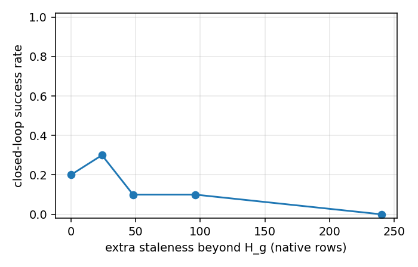

# goal 陈旧度（staleness）对闭环的影响

## 问题

GlanceWAM 的动作头条件在视频 DiT 生成、每 `H_g`(=48，2.4s @20Hz) 行刷新一次的 goal latent 上。
直接拿这个 goal 当"规划目标"在闭环里不稳（见 `results/wm_goal/`）。本实验**单独隔离 staleness**：
把 goal 的刷新间隔拉长、让它比训练时更旧，看控制如何退化。

## 方法

- 旋钮：客户端 `GLANCEWAM_GOAL_REFRESH_ROWS`（每 N 行刷新一次 goal，默认 H_g）。刷新间隔 > H_g 即让
  goal 多用 `N - H_g` 行；此时喂给动作头的有效距离仍按训练分布 clamp 到 1 行（纯 staleness 应激）。
- 协议：`protocol_task1_all10.json`（task1 / libero_goal，初态 0–9，color_strong），base checkpoint。
- 档位：刷新间隔 = `1,1.5,2,3,6 × H_g` → 48/72/96/144/288，每档 10 回合。

## 结果（每档 10 回合）

| 刷新间隔 | 额外 staleness(行) | 成功 | 平均步数 |
|---|---|---|---|
| 48（训练档） | 0 | 2/10 = 0.20 | 259 |
| 72 | 24 | 3/10 = 0.30 | 239 |
| 96 | 48 | 1/10 = 0.10 | 282 |
| 144 | 96 | 1/10 = 0.10 | 288 |
| 288（≈冻结） | 240 | 0/10 = 0.00 | 300（打满） |



## 结论（诚实）

1. **成功率随 staleness 非单调、噪声大**（R72 反超 R48）；早期 n=5 看到的"0.40→0.20→0.00"是噪声，
   不能当"越旧越差"的证据。
2. **唯一稳健的信号：相对陈旧越狠，回合越长、失败拖到超时**（平均步数 259→239→282→288→300）。
3. 只有**极端陈旧（≈冻结 goal，R288）明确失败**（0/10、全程 300）。
   → 可辩护的说法是"陈旧主要把回合推向超时，中等陈旧对成功率无稳定单调影响，极端陈旧才明确失败"。

## 复跑

```bash
cd /root/autodl-tmp/wam_glance_project/glance_wam_light
OMP_NUM_THREADS=8 /root/wam_sim_env/bin/python day1/run_staleness_sweep.py \
  --protocol results/task1/protocols/protocol_task1_all10.json --condition color_strong \
  --ckpt results/day1_base/checkpoints/steps_15000_pytorch_model_ema.pt --model-name base \
  --out results/staleness/task1_base_10ep --H-g 48 --multipliers 1,1.5,2,3,6 \
  --driver-args --target-body flat_stove_1
```

代码：`day1/goal_staleness.py`（纯算术+聚合，含单测 `day1/test_goal_staleness.py`）、
`day1/run_staleness_sweep.py`（逐档跑 + 聚合出曲线）。
